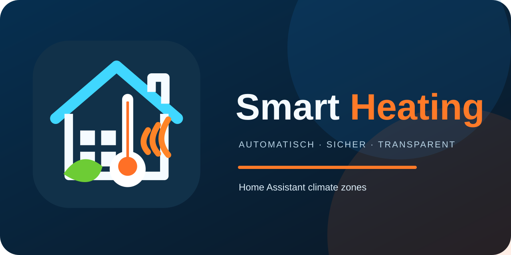
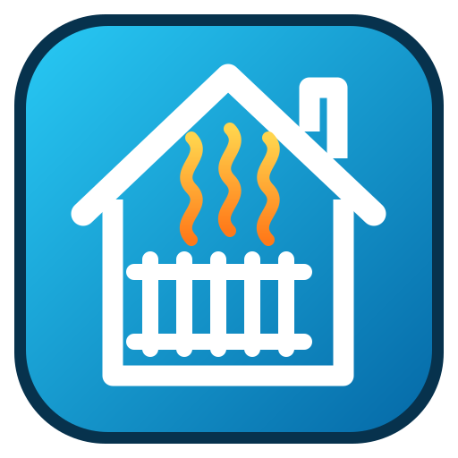
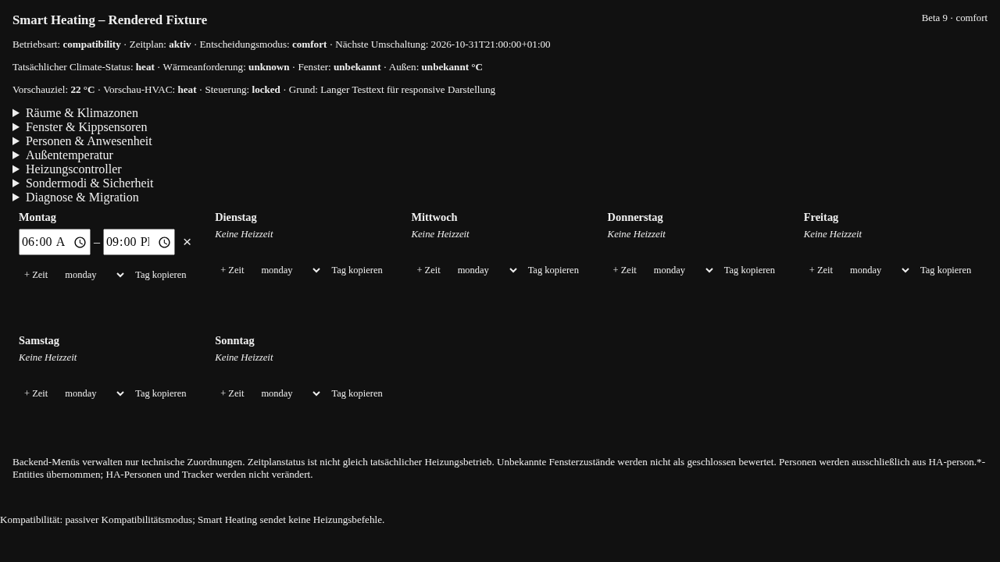

<h1 align="center">Smart Heating</h1>

<strong>Transparent heating schedules and decision previews for Home Assistant</strong>

<a href="README.md">🇩🇪 Deutsch (primary)</a> · <a href="README.en.md">🇬🇧 English</a>

> [!IMPORTANT]
> **Stable – Coming Soon.** Smart Heating is currently in beta and undergoing real-world testing. **No stable release is available yet.** The development-branch manifest currently declares `0.1.0-beta.54`; this is not evidence that a release has been approved or published. The current integration is **passive**: it displays schedules and decisions but does **not** autonomously control heating. Active control requires separate validation and explicit approval.

## Overview

Smart Heating brings weekly schedules, comfort and setback temperatures, rooms, window contacts, presence signals, and special modes into a Home Assistant integration. Its goal is transparent, auditable heating decisions without silently taking over existing automation.

**Beta capabilities:** weekly comfort windows per weekday, multi-day copying, room and temperature overview, window and presence inputs, special modes (including chimney sweep), a readable priority overview, diagnostics, passive decision previews, and a read-only Lovelace card with a visual editor.

Actual compatibility depends on the entities and integrations available in your Home Assistant setup. **Active thermostat control is not a released beta feature.**

## Screenshots

| Desktop | iPhone |
|---|---|
|  |  |

*Screenshots show a development build and may differ from the latest UI.*

## Requirements

- Home Assistant **2026.10.0 or later** (per HACS metadata).
- HACS for custom repository installation.
- Configured Home Assistant sensors and thermostats for meaningful readings.
- Verified legacy-automation evidence if you want to compare decisions.

## Passive parallel operation and rollback

**Explicit approval is required before the first production installation.** Smart Heating currently provides previews only and must not replace or disable the existing heating automation. Keep the legacy automation, Tado configuration, helpers and window contacts unchanged.

After an approved installation, verify diagnostics and schedule previews first. Smart Heating must not issue climate, boiler or helper service commands. If a problem occurs, disable the Smart Heating integration under **Settings → Devices & services**, or select the last known-good *published* version in HACS and restart Home Assistant if required. The existing heating automation remains active throughout.

Do not create extra backups or snapshots for this work or modify existing backups.

## Install through HACS

1. In **HACS**, open **Custom repositories**.
2. Add `https://github.com/balronu/ha-smart-heating` as an **Integration**.
3. Find **Smart Heating** and select an **actually published beta release**. A commit on `main` is not itself a release.
4. Install and restart Home Assistant if requested.
5. Go to **Settings → Devices & services → Add integration → Smart Heating**.

Keep existing heating automations running while evaluating the passive beta.

## Initial configuration

1. Open Smart Heating management and confirm the configuration entry is available.
2. Assign the rooms, thermostats, and sensors supported by your installation.
3. Configure comfort/setback temperatures and weekly time windows.
4. Review window, presence, and special-mode rules.
5. Check status and diagnostics for missing inputs and confirm the integration remains **passive**.

Unknown or unavailable signals must not be treated as confirmed readings.

## Add the Lovelace card

1. Edit a Home Assistant dashboard and choose **Add card**.
2. Search for **Smart Heating**, or use `custom:smart-heating-card`.
3. Configure title, display mode, visible sections, and temperature/window options in the visual editor.
4. With exactly one active Smart Heating configuration entry, the card resolves it automatically. Existing explicit entry IDs remain supported; ambiguous multiple entries are not selected arbitrarily.
5. Save. The card is **read-only** and never sends heating commands.

The integration normally registers the JavaScript resource automatically.

## Weekly schedule, modes, and priorities

Set comfort windows per weekday; outside these windows the configured setback behavior applies unless a higher-priority condition takes effect. Windows may cross midnight. Changes require an explicit save.

Special modes can override regular scheduling according to their configured effects. The backend shows a priority ranking. **Chimney sweep always has the highest fixed priority.** Priority does not automatically imply that a mode bypasses window or presence rules; those effects are configured separately. Equal priority values require careful review.

## Safety and active-control roadmap

The current beta is for **observation and passive evaluation only**. Existing automations retain control. Never enable two independent controllers to write to the same thermostat simultaneously.

Any later active takeover requires validation of sensor quality, safety priorities, window/presence behavior, scheduling, special modes, actuator feedback, and a safe handover from the legacy automation. **There is no automatic switch to active control.**

## Troubleshooting

| Symptom | Check |
|---|---|
| Card shows “unknown” | Configuration entry, backend data, and entity availability |
| Blank card | Home Assistant restart after install and browser refresh |
| No rooms | Room mapping and source entities |
| Unexpected schedule | Saved time windows, timezone, modes, and priorities |
| Comparison unavailable | Verified legacy decision evidence may be missing |
| Multiple entries | Resolve ambiguous configuration; no arbitrary auto-selection |

Please [open an issue](https://github.com/balronu/ha-smart-heating/issues) with versions, reproduction steps, and sanitized diagnostics. Never post credentials or tokens.

## Further reading

[German documentation](README.md) · [Architecture](docs/ARCHITECTURE.md) · [Migration and safety](docs/MIGRATION.md) · [Changelog](CHANGELOG.md) · [Releases](https://github.com/balronu/ha-smart-heating/releases) · [License](LICENSE)

**Roadmap:** passive beta and live comparison → safety validation → controlled active trial → **Stable (Coming Soon)**. No release date is promised.
