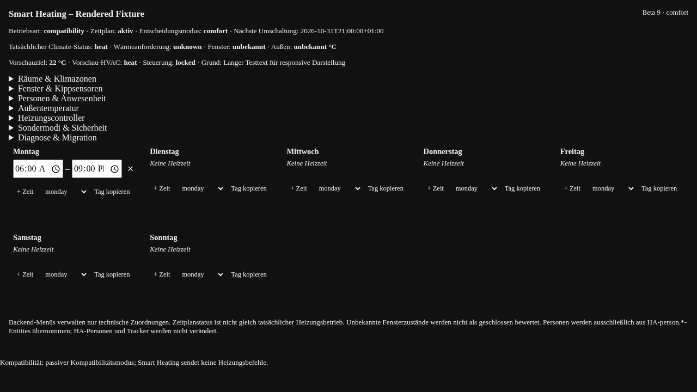
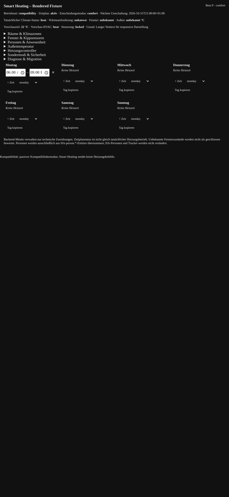

# Smart Heating (Beta 24)

## Beta-24-iPhone-Abnahme

Die Verwaltung ist für schmale iPhone-Ansichten gehärtet: Zeitfelder werden
bei Bedarf untereinander dargestellt, deutsche Begriffe umbrechen nicht mitten
im Wort, und der Wochenplan meldet ungespeicherte beziehungsweise gespeicherte
Änderungen ausdrücklich. Raum-/Klimazonen-Zuordnungen zeigen gespeicherte Werte
und übernehmen neue Auswahl erst nach dem Speichern.

Fensterkontakte zeigen Raum, Zustand und Eignung getrennt. `unknown` und
`unavailable` werden als **unbekannt** beziehungsweise **nicht verfügbar**
angezeigt; ignorierte Sensoren bleiben separat einklappbar. Sondermodi trennen
Verfügbarkeit, Aktivität und Statusquelle. Alle Funktionen bleiben passiv.

## Beta-23-UX-Abnahme

Die Versionsanzeige verwendet die vom Backend-WebSocket gelieferte zentrale
Integrationsversion. Frontend-Fallbacks zeigen keine erfundene Release-Version
mehr an; dadurch werden veraltete JavaScript-Caches sichtbar statt als aktuelle
Version ausgegeben. Die mobile Verwaltung gruppiert Geräte zuerst nach dem
aktuellen HA-Bereich, bietet geeignete Geräte anderer Bereiche danach an und
trennt Raum-, Kontakt-, Außen- und technische Temperaturquellen. Wochenplan,
Fensterkontakte, ignorierte Sensoren, Personen und Sondermodi bleiben passiv;
bestehende Zuordnungen werden nicht automatisch verändert.

## Beta-23-Verwaltungsoberfläche

Die Verwaltungsoberfläche bietet eine kompakte, mobile Wochenplanbearbeitung
mit nativen Zeitfeldern, nicht überlappenden Komfortfenstern, Tageskopie und
sichtbarer Speicher-/Validierungsrückmeldung. Raumthermostate und geeignete
Raumtemperaturfühler werden zuerst aus dem HA-Bereich und zusätzlich aus
„Weitere geeignete Geräte“ angeboten; Geräte ohne HA-Bereich bleiben damit
manuell auswählbar. Technische Temperaturquellen werden nicht als Raumfühler
vorgeschlagen, und gespeicherte, aktuell nicht verfügbare Zuordnungen werden
zur Prüfung erhalten.

Die HA-Bereichsrelevanz ist von der Aktivierung eines Smart-Heating-Raums
getrennt. Die Oberfläche verändert keine HA-Bereiche und bleibt im passiven
Kompatibilitätsmodus.

## Verbindliche Begriffe und Oberflächen

- **Frontend – Lovelace-Karte:** Heizungsstatus, Visualisierung und passive Wochenplanvorschau.
- **Verwaltungsoberfläche – Smart Heating im HA-Seitenmenü:** Wochenpläne, Klimazonen, Räume, Temperaturfühler, Fensterkontakte, Personen und beobachtbare Steuerungssignale.
- **Integrationskonfiguration – HA-Optionsdialog:** technische Optionen wie Betriebsmodus, Sommerstrategie sowie Schornsteinfeger- und Frostschutzwerte.
- **Smart Heating Integration:** technische Home-Assistant-Integration.
- **Smart Heating Verwaltung:** eigenständige Oberfläche im HA-Seitenmenü.
- **Smart Heating Einstellungen:** nativer Home-Assistant-Optionsdialog.
- **Smart Heating Dashboard-Karte:** Lovelace-Frontend zur Anzeige und späteren Bedienung.

Im Optionsdialog ist **Nur beobachten (aktuell)** voreingestellt. Smart Heating berechnet Heizbedarf und Empfehlungen, ohne Thermostate, Automationen oder andere Geräte zu verändern. **Heizung aktiv steuern** ist noch nicht verfügbar und serverseitig gesperrt. Die Sommerstrategie ist davon getrennt und schaltet im Beobachtungsmodus keine Thermostate aus.

**Smart Heating** ist eine HACS-kompatible Home-Assistant-Integration für
Wochenzeitpläne, Status, Simulation und eine kompakte Lovelace-Karte.

> **Beta-11-Sicherheitsgrenze:** Die Integration berechnet die vollständige
> Heizungsentscheidung passiv. Sie schaltet
> keine Climate-Entity, keinen bestehenden Helper, keinen Scheduler und keinen
> Sondermodus. Eine Migration in eine produktive Heizungssteuerung ist nicht
> enthalten.

> **Phase-26-Sicherheitsgrenze (01.11.2026):** Beta 19 ist ausschließlich im
> Entwicklungsrepository veröffentlicht und wird nicht automatisch auf VM 104
> installiert. Die produktive Instanz wurde nur lesend untersucht; beide
> vorhandenen Config Entries bleiben unverändert.

## Beta-19-Verwaltung und Klimazonen

Beta 19 führt die eigenständige, passive Smart Heating Verwaltung für Personen,
Klimazonen, Thermostate, Fenster-/Kippkontakte, Raumtemperaturfühler,
Außentemperatur und einen zentralen Controller. Änderungen werden über
Config-Entry-Optionen beziehungsweise die unterstützte WebSocket-API
gespeichert; Home-Assistant-Entities werden niemals angelegt oder gelöscht.
Personen stammen ausschließlich aus `person.*`. Unbekannte Anwesenheit wird
nicht als Abwesenheit interpretiert. Ein Thermostat darf nicht zwei aktiven
Zonen zugeordnet sein. Die Verwaltungsbereiche sind unabhängig aufklappbar; HA-Bereiche werden nur gelesen, getrennt dargestellt und erst nach ausdrücklicher interner Auswahl als heizungsrelevant geführt.

## Funktionen

- UI-basierter Config Flow und Options Flow
- persistenter Wochenplan in der Config Entry
- mehrere nicht überlappende Fenster pro Wochentag
- serverseitige Zeitberechnung und `next_switch`
- Simulation der dokumentierten Prioritätsreihenfolge
- read-only Diagnose und Migration-Preview
- kompakte responsive Lovelace-Karte mit eigener, validierter Planverwaltung
- deutsche und englische Übersetzungen
- vorsichtige automatische Entity-Erkennung mit sichtbaren Mehrdeutigkeiten und Klassifikation technischer Temperaturquellen
- Migrationsplan mit Single-Writer-Sperre, Bestätigungstoken, Snapshot,
  Read-back und isoliertem Rollback-Adapter
- erklärbare Entscheidung mit aktivem Modus, Grund, Zieltemperatur und HVAC-Ziel
- getrennter Kompatibilitäts- und Vollmodus
- isolierter Climate-Servicepfad mit Primär-/Tado-Fallback, Read-back und Rollback
- Kompatibilitäts-Sommermodus sowie ausdrücklich gesperrter HVAC-Off-Planung
- isolierter Home-Assistant-Lifecycle-Test für Flow, Entities und Neustart
- explizite Entity-Zuordnung im Options Flow mit persistenter Rückwärtskompatibilität
- unbekannte Fensterzustände werden in der Vorschau als unbekannt statt geschlossen gezeigt
- eigener persistenter interner Betriebszustand mit nativen Switch-/Select-/Number-/Sensor-Entitäten
- eigener passiver Wochenplaner; Simple Scheduler und manuell angelegte Helfer sind für Smart Heating nicht erforderlich
- grafischer Wochenplan mit sieben Tagen, mehreren Zeitfenstern und optionalen Zieltemperaturen
- nativer Options-Dialog mit verständlichen Betriebs-/Sicherheitsfeldern statt YAML-Objekteditor

## Branding

Die eigenständigen Branding-Dateien liegen unter [`brand/`](brand/):
quadratische Marke ohne Schriftzug als SVG/PNG, transparente Variante und
GitHub-Banner. Sie greifen Haus, Thermometer, Wärme, Blau und Orange der
Designvorlage auf. Die Grafiken sind Projekt-Assets; eine offizielle
Marketplace- oder HACS-Branding-Aufnahme wird hier nicht behauptet.

## Oberflächen

Die normale Lovelace-Karte enthält ausschließlich Heizstatus, Sondermodi und
Wochenzeitplan. Die technische Verwaltung ist davon getrennt und wird als
eigenständiges Home-Assistant-Seitenmenü **Smart Heating** geöffnet. Sie enthält
die sieben geschlossenen Bereiche Räume & Klimazonen, Fenster & Kippsensoren,
Personen & Anwesenheit, Außentemperatur, Heizungscontroller, Sondermodi &
Sicherheit sowie Diagnose & Migration. Die gerenderten Oberflächen wurden in
den UI-Fixtures auf Desktop, iPhone, iPad und engem Touchmonitor geprüft:




Das Panel gruppiert Fensterkontakte nach HA-Räumen und bietet Suche sowie
Statusfilter. Automatisch erkannt werden ausschließlich `binary_sensor`-
Entities mit `window`, `door` oder `opening`; Batterie-, Diagnose-,
Temperatur- und andere Neben-Entities werden ausgeschlossen. Bestehende
ungeeignete Zuordnungen bleiben erhalten und werden nur zur manuellen Prüfung
markiert.

Der native Options-Dialog enthält bewusst nur die vier sicheren Betriebs- und
Sicherheitswerte. Der Wochenplan wird im Panel grafisch bearbeitet; dadurch
bleiben bestehende Zeitfenster und optionale Zieltemperaturen beim Speichern
anderer Optionen vollständig erhalten.

## Installation

Beta 19 ist ein GitHub-Prerelease. In HACS muss die Vorabversion explizit
aktiviert werden. Danach über **HACS → Integrationen → Smart Heating**
installieren. Ein erforderlicher Home-Assistant-Neustart ist separat zu
prüfen und darf erst nach Freigabe durchgeführt werden.

Alternativ kann das Repository als benutzerdefiniertes HACS-Repository
(`Integration`) hinzugefügt werden. Die Integration darf zunächst nur in einer
Testinstanz installiert werden.

## Einrichtung

1. **Einstellungen → Geräte & Dienste → Integration hinzufügen → Smart
   Heating**.
2. Nur Name und Zeitzone festlegen. Legacy-Helper erscheinen nicht im initialen Flow.
3. Erkannte Vorschläge auf der Bestätigungsseite prüfen und ausdrücklich bestätigen.
4. Im Seitenmenü **Smart Heating** die technische Verwaltung öffnen. Alle sieben
   Bereiche sind zunächst geschlossen und unabhängig aufklappbar; Räume und
   Zonen sind zusätzlich einzeln aufklappbar. Die Lovelace-Karte bleibt davon
   getrennt und enthält keine technische Geräteverwaltung.
5. Die Karte mit `entry_id` der Config Entry in ein Testdashboard aufnehmen:

```yaml
type: custom:smart-heating-card
entry_id: YOUR_CONFIG_ENTRY_ID
```

Die Karte bearbeitet ausschließlich den Zeitplan dieser Smart-Heating-Entry.
Sie schreibt keine bestehenden Heizungs-Entities.

### Beta-19-Smart-Heating-Verwaltung

Das Seitenpanel zeigt den Wochenplan als kompakte Tagesübersicht. Nur der
ausgewählte Tag wird bearbeitet; Fenster können mit optionaler Zieltemperatur
hinzugefügt, geändert und entfernt werden. Speichern erfolgt ausdrücklich und
meldet Erfolg oder Validierungsfehler sichtbar zurück. Die sieben
Verwaltungsbereiche bleiben unabhängig aufklappbar und zeigen Leerzustände.

### Beta-12-Installationsassistent

Die Migrations-Preview zeigt erkannte Entities und Konflikte. Der
Kompatibilitätsmodus ist der sichere Standard: Smart Heating beobachtet den
Zeitplan und lässt die bestehende Automation am Thermostat schreiben. Wenn
Simple Scheduler keinen unterstützten Export bereitstellt, verlangt die UI
einen validierten manuellen Vorschlag. Der Vollmodus bleibt gesperrt, bis ein
einzelner Schreiber in einer ausdrücklich isolierten Umgebung nachgewiesen ist.

Der Schornsteinfeger-Modus hat in der Entscheidungsansicht absolute Priorität.
Ein Sollwert oder `hvac_action` beweist jedoch keinen Brennerstart.

Der Options Flow kann die eindeutigen Zuordnungen der Bestandsanlage nachträglich
speichern: Primär-Climate, Tado-Fallback, Zeitstatus, Heizfreigabe, Sollwerte,
Außentemperatur, Fenster, Anwesenheit und Sondermodi. Vorschläge werden erst
nach ausdrücklicher Bestätigung gespeichert; Mehrdeutigkeiten bleiben offen.
Fenster werden auf geeignete `binary_sensor`-Entities mit Öffnungs-Device-Class
beschränkt. Personen stammen ausschließlich aus `person.*`; Tracker, Batterie-,
Temperatur-, Diagnose- und Fahrzeug-Entities werden ausgeschlossen. Unbekannte
Fensterzustände werden nicht als geschlossen bewertet.

## Referenzmigration

Die Referenzanlage nutzt `input_boolean.heizung` als Zeit-/Kalenderstatus und
hat Sondermodi mit einer dokumentierten Priorität. Die ursprünglichen Simple-
Scheduler-Zeitpläne werden als **unverifizierte Importquelle** behandelt, bis
ein unterstützter Export vorliegt:

- Montag–Freitag Heizbeginn 05:30
- Samstag–Sonntag Heizbeginn 07:00
- Sonntag–Donnerstag Absenkung 21:00
- Freitag–Samstag Absenkung 22:00

Beta 13 übernimmt diese Werte nicht automatisch und schreibt `input_boolean.heizung`
nicht. Die Migrations-Preview zeigt nur einen Konflikt-/Prüfstatus. Der
ausführbare Adapter akzeptiert Schreibzugriffe ausschließlich über einen
isolierten Test-Transport; die Produktiv-Sperre verweigert die Aktivierung,
solange der alte Schreiber nicht nachweisbar abgelöst ist.

## Entscheidungslogik

Die Referenzreihenfolge ist unverändert: Schornsteinfeger → fehlende
Heizfreigabe → Fenster offen → Fenster gekippt → Abwesenheit → Nacht/Party →
Sommermodus ohne Komfortoverride → Komfort. Die Karte trennt Zeitplanstatus,
berechneten Heizmodus und tatsächliche Produktivsteuerung. Die Beta führt keine
Climate- oder Helper-Services aus. Smart Heating verwaltet seinen eigenen
Zustand und Wochenplan persistent in der Config Entry und stellt dafür native
HA-Entitäten bereit; Simple Scheduler und manuell angelegte Helper sind daher
für den Integrationsbetrieb nicht erforderlich. Im Kompatibilitätsmodus bleibt
die Heizungs- und Controller-Steuerung gesperrt.

**Schornsteinfeger hat absolute Priorität:** Auch bei 40 °C Außentemperatur,
Sommermodus, ausgeschalteter Heizfreigabe, Nacht, Abwesenheit und offenen
Fenstern wird im Planer `heat` mit der konfigurierten
Schornsteinfeger-Solltemperatur angefordert. Ein hoher Sollwert allein wird
nicht als Brennerstart behauptet; dafür muss das Gerät `hvac_action` oder einen
gleichwertigen Wärmeerzeugerstatus liefern.

## Entwicklung

```bash
python -m unittest discover -s tests -p 'test_*.py' -v
python -m compileall -q custom_components tests
git diff --check
```

Die HA-abhängigen Adapter werden in CI mit Home Assistant 2026.10.4 in einer
isolierten Fixture getestet. Eine Installation in produktiver VM 104 ist kein
Teil der Beta-11-Entwicklung. Der Kompatibilitätsmodus ist passiv; der Vollmodus
bleibt bis zu einem gesondert geprüften Single-Writer-Nachweis gesperrt.

## Status

Version: `0.1.0-beta.24`
Release-Typ: Entwicklungsrelease / HACS-Prerelease  
Produktive Migration: gesperrt; nur isolierter Adapter-Test möglich

Weitere Architektur- und Sicherheitsdetails stehen in
[`docs/ARCHITECTURE.md`](docs/ARCHITECTURE.md).
