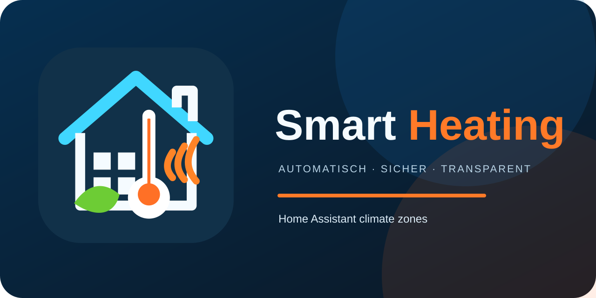
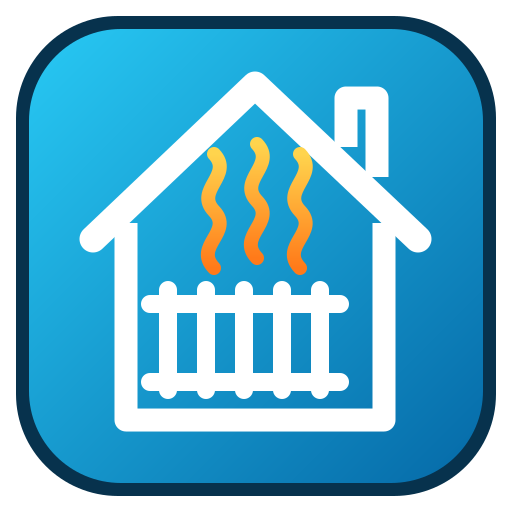
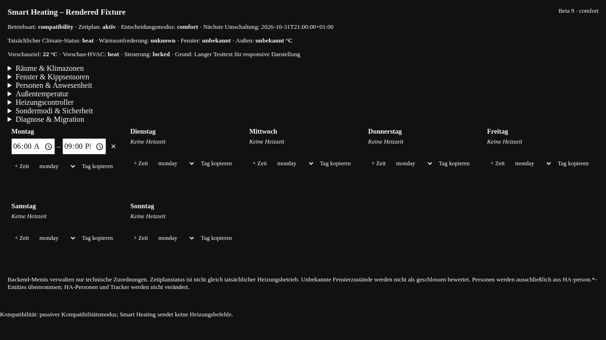

<h1 align="center">Smart Heating</h1>

<strong>Intelligente, nachvollziehbare Heizungsplanung für Home Assistant</strong>

<a href="README.md">🇩🇪 Deutsch</a> · <a href="README.en.md">🇬🇧 English</a>

<a href="https://github.com/balronu/ha-smart-heating/releases">Releases</a> · <a href="https://github.com/balronu/ha-smart-heating/issues">Fehler melden</a> · <a href="CHANGELOG.md">Changelog</a>

> [!IMPORTANT]
> **Stable – Coming Soon.** Smart Heating befindet sich in der Beta- und Praxistestphase. **Eine Stable-Version ist noch nicht freigegeben.** Das Manifest des Entwicklungsbranches trägt derzeit `0.1.0-beta.55`; daraus folgt noch keine Freigabe oder Veröffentlichung eines Releases. Die Integration arbeitet im aktuellen Entwicklungsstand **passiv**: Sie zeigt Planungen und Entscheidungen an, übernimmt aber **nicht** selbstständig die Heizungssteuerung. Ein späterer aktiver Betrieb wird erst nach gesonderter Prüfung und ausdrücklicher Freigabe möglich.

## Nächste Beta – getrennte Raumziele und Badezimmer-IR (Entwicklung)

Die nächste Entwicklung trennt Raumziel, gemessene Raumtemperatur,
Thermostat-Sollwert und passiven Heizbedarf. Für Badezimmer, Esszimmer,
Wohnzimmer und Schlafzimmer gelten nur als interne Standard-Raumziele 24 °C,
21 °C, 22 °C und 18 °C. Bestehende Thermostat-Sollwerte – beispielsweise 27 °C
im Badezimmer zum Offenhalten des Ventils – werden nur gelesen und nicht als
Raumziel übernommen.

Die Badezimmer-Infrarotheizung kann als separate Klimaquelle konfiguriert
werden. Ihre Automatik ist standardmäßig deaktiviert. In der passiven Vorschau
sind Komfort- und Absenktemperatur sowie „ausschalten“ oder „auf
Absenktemperatur regeln“ sichtbar. Fenster-, Zeitplan-, Anwesenheits- und
Sondermodusregeln werden unabhängig von der zentralen Gasheizungsanforderung
bewertet; produktive Climate-Aufrufe bleiben gesperrt.

## Was ist Smart Heating?

Smart Heating führt Wochenpläne, Heiz- und Absenktemperaturen, Raumdaten, Fensterkontakte, Anwesenheit und Sondermodi in einer zentralen Home-Assistant-Oberfläche zusammen. Entscheidungen werden nachvollziehbar dargestellt, statt die bestehende Heizung unbemerkt zu verändern.

**Bereits enthalten (Beta):**
- **Wochenplan:** Komfortfenster für jeden Wochentag, Zeit- und Temperaturwerte, Kopieren auf mehrere Tage.
- **Räume und Temperaturen:** konfigurierte Bereiche sowie verfügbare Ist- und Sollwerte.
- **Fenster und Anwesenheit:** Einbeziehung verfügbarer Signale in die passive Entscheidungsvorschau.
- **Sondermodi:** z. B. Heimweg, Party, Besuch, Sommermodus und Schornsteinfeger; mit Übersicht der Prioritäten und Wirkungen.
- **Transparenz:** Status, Diagnosen, Datenqualität und Vergleich mit der bisherigen Steuerung, soweit verifizierbare Daten vorliegen.
- **Lovelace-Karte:** übersichtliche, ausschließlich lesende Anzeige mit deutschem grafischem Editor.

> **Wichtig:** Nicht jede Sensorquelle und jedes Thermostat wird automatisch unterstützt oder gesteuert. Die Integration verwendet die in Home Assistant tatsächlich vorhandenen und zugeordneten Entitäten. Eine aktive Thermostatsteuerung ist **kein** freigegebenes Beta-Merkmal.

## Screenshots

| Desktop | iPhone |
|---|---|
|  |  |

*Die Bilder zeigen den Entwicklungsstand; die aktuelle Oberfläche kann abweichen.*

## Voraussetzungen

- Home Assistant **2026.10.0 oder neuer** (laut HACS-Metadaten).
- HACS für die Installation als benutzerdefiniertes Repository.
- Für sinnvolle Ergebnisse: bereits in Home Assistant eingerichtete Temperatur-, Fenster- und gegebenenfalls Anwesenheitssensoren.
- Für einen Vergleich mit der bisherigen Heizungsautomation: passende Bestandsdaten und überprüfbare Entscheidungsnachweise.

## Passiver Parallelbetrieb und Rückkehr

**Vor der ersten Installation ist eine ausdrückliche Freigabe erforderlich.** Smart Heating ist im aktuellen Stand eine reine Vorschau und darf die vorhandene Heizungsautomation nicht ersetzen. Die bestehende Automation `automation.heizung_automatik_ersetzt_node_red` bleibt eingeschaltet; vorhandene Tado-Konfiguration, Helfer und Fensterkontakte bleiben unverändert.

Nach einer freigegebenen Installation zuerst nur die Diagnosen und Wochenplan-Vorschau kontrollieren. Es dürfen keine Heizbefehle, Thermostat-Sollwertänderungen oder Schaltvorgänge von Smart Heating ausgehen. Bei Fehlern die Smart-Heating-Integration in **Einstellungen → Geräte & Dienste** deaktivieren beziehungsweise die zuletzt funktionierende, tatsächlich veröffentlichte Version in HACS auswählen und den nötigen Neustart ausführen. Die bisherige Heizungsautomation bleibt dabei durchgehend aktiv; es ist keine Umschaltung auf Smart Heating erforderlich.

Keine zusätzlichen Backups oder Snapshots für diese Prüfung erstellen und keine vorhandenen Sicherungen verändern.

## Installation der Beta über HACS

1. Öffne **HACS** in Home Assistant.
2. Öffne das Menü für **benutzerdefinierte Repositories** und füge `https://github.com/balronu/ha-smart-heating` als **Integration** hinzu.
3. Suche **Smart Heating** und wähle die gewünschte **veröffentlichte Beta-Version** aus. Ein Commit auf `main` allein ist noch kein Release.
4. Installiere die Integration und starte Home Assistant neu, wenn HACS dies verlangt.
5. Gehe zu **Einstellungen → Geräte & Dienste → Integration hinzufügen → Smart Heating** und richte den Konfigurationseintrag ein.

**Bei Updates:** In HACS eine tatsächlich veröffentlichte Version wählen und die Release-Hinweise beachten. Bestehende Automationen nicht vorschnell abschalten.

## Erste Einrichtung

1. Öffne die **Smart-Heating-Verwaltung** und prüfe, ob der Konfigurationseintrag erkannt wurde.
2. Ordne die vorhandenen Räume, Thermostate und Sensoren entsprechend der angebotenen Optionen zu.
3. Lege Komfort- und Absenktemperaturen sowie den **Wochenplan** fest.
4. Prüfe Fenster-, Anwesenheits- und Sondermodusbedingungen.
5. Kontrolliere in **Status / Diagnose**, ob die erforderlichen Eingangsdaten verfügbar sind und ob die Integration weiterhin **passiv** arbeitet.

Fehlende oder unbekannte Daten dürfen nicht als verlässlich gemessene Werte interpretiert werden.

## Lovelace-Karte hinzufügen

1. Öffne ein Home-Assistant-Dashboard und wähle **Dashboard bearbeiten → Karte hinzufügen**.
2. Suche **Smart Heating** oder verwende den Kartentyp `custom:smart-heating-card`.
3. Konfiguriere Titel, Darstellung, sichtbare Bereiche und die gewünschten Temperatur- und Fensterinformationen im grafischen Editor.
4. **Config Entry ID:** Bei genau einem aktiven Smart-Heating-Konfigurationseintrag wird dieser automatisch erkannt. Bestehende Karten mit gespeicherter ID bleiben kompatibel. Bei mehreren Instanzen wird nicht willkürlich eine ausgewählt.
5. Speichere die Karte. Sie zeigt Daten an, sendet aber keine Heizbefehle.

Die Kartenressource wird von der Integration registriert; normalerweise ist keine manuelle JavaScript-Ressource erforderlich.

## Wochenplan und Sondermodi

Im Wochenplan legst du pro Wochentag Komfort-Zeitfenster fest. Außerhalb dieser Fenster gelten die vorgesehenen Absenkregeln, soweit keine höherrangige Bedingung eingreift. Ein Zeitfenster kann über Mitternacht laufen. Änderungen werden erst mit **Wochenplan speichern** übernommen.

Sondermodi können die normale Planung beeinflussen. Die Backend-Ansicht zeigt die gespeicherten Prioritäten als Rangfolge. **Schornsteinfeger hat die fest vorgegebene höchste Priorität**; die übrigen Modi werden anhand ihrer konfigurierten Prioritäten bewertet. **Priorität und Wirkung sind nicht dasselbe:** Ob ein Modus Fenster-, Anwesenheits- oder Zeitplanbedingungen übersteuert, hängt von seiner jeweiligen Konfiguration ab. Bei gleichen Prioritätswerten muss das Verhalten gesondert geprüft werden.

## Sicherheit und Übergang zum aktiven Betrieb

Die aktuelle Beta ist für **Beobachtung, Konfiguration und passive Auswertung** vorgesehen. Bestehende Heizungsautomationen bleiben die zuständigen Steuerungen. Smart Heating darf nicht parallel als zweiter Schreiber auf dasselbe Thermostat geschaltet werden.

Vor einer späteren aktiven Freigabe müssen mindestens Sensorqualität, Prioritäten, Fenster-/Abwesenheitsfälle, Wochenplan, Sondermodi, tatsächlicher Aktorpfad und die sichere Übergabe von der bisherigen Automation überprüft sein. **Es gibt keine automatische Umschaltung auf aktiv.**

## Fehlerbehebung

| Symptom | Prüfen |
|---|---|
| Karte zeigt „unbekannt“ | Konfigurationseintrag vorhanden? Backend-Daten und Entitäten verfügbar? |
| Karte bleibt leer | Home Assistant nach Installation neu gestartet? Browseransicht aktualisiert? |
| Keine Räume | Raumzuordnung und Datenquellen in der Verwaltung prüfen |
| Zeitplan wirkt nicht wie erwartet | Gespeicherte Fenster, Zeitzone, Sondermodi und Prioritäten prüfen |
| Vergleich nicht möglich | Verifizierte Daten der bisherigen Automation fehlen möglicherweise |
| Mehrere Konfigurationseinträge | Keine automatische Auswahl; bestehende eindeutige Zuordnung prüfen |

Bei Problemen bitte [ein Issue eröffnen](https://github.com/balronu/ha-smart-heating/issues) und Home-Assistant-Version, Smart-Heating-Version, Reproduktionsschritte und anonymisierte Diagnosedaten angeben. **Keine Tokens, privaten Adressen oder Zugangsdaten veröffentlichen.**

## Dokumentation und Projektstatus

- [Englische Anleitung](README.en.md)
- [Architektur und technische Hintergründe](docs/ARCHITECTURE.md)
- [Migration und Sicherheitskonzept](docs/MIGRATION.md)
- [Änderungsprotokoll](CHANGELOG.md)
- [Releases](https://github.com/balronu/ha-smart-heating/releases)
- [Lizenz](LICENSE)

**Roadmap:** Beta-Oberfläche und passiver Live-Test → nachvollziehbare Auswertung und Sicherheitsfreigaben → kontrollierter aktiver Praxistest → **Stable (Coming Soon)**. Ein Veröffentlichungsdatum wird bewusst noch nicht zugesagt.
